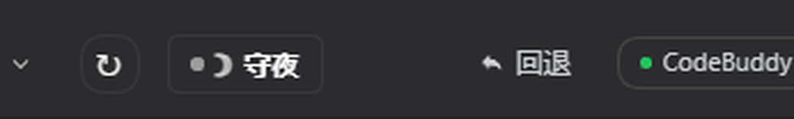
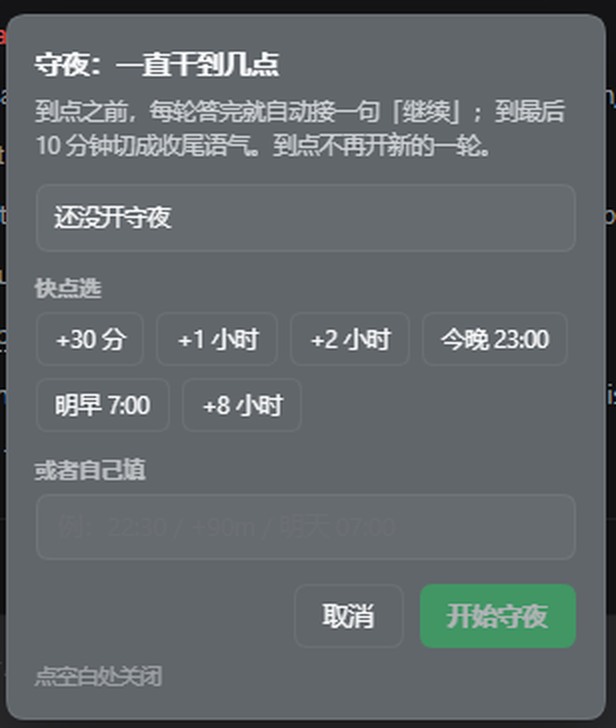

# dsh-run-until — 让对话一直跑到某个钟点，然后自己停

> Keep a DeepSeek Harness session working until a wall-clock deadline, then stop.
> A one-click button in the composer plus a `/run-until` command.

给 DSH 的输入框加一颗「☽ 守夜」按钮：点一下选个截止时间，之后每轮答完就自动接一句「继续」，
一直跑到点为止；到点不再开口。适合「去上学，让它自己干活到晚上七点」这种场景。

同样的功能也有一条 `/run-until` 指令（在输入框里敲 `/run-until 22:30` 一样能用），
但平时用按钮就够了 —— 按钮不会在对话流里留下任何痕迹。






## 用法（按钮）

输入框左下角有一排小按钮（在「完全权限」右边、和「↻ 迭代」并排），里面那颗 **`☽ 守夜`** 就是它。

1. 点 `☽ 守夜` → 弹出一张小卡片；
2. 六个快捷选项任点一个：`+30 分` / `+1 小时` / `+2 小时` / `今晚 23:00` / `明早 7:00` / `+8 小时`；
   或者在最下面的输入框里自己填一个时间（写法见下表），回车即可；
3. 点「开始守夜」。

开起来之后：

- 按钮变成 **`☽ 守夜 · 3h20m`**，那个数字是剩余时间，会自己倒数；
- 再点一次卡片，顶部显示「守夜进行中 · 还剩 … · 已接 N 轮」，可以改时间（按钮变成「改到」）或者点红色的「立刻停」；
- 最后 10 分钟按钮会变成「快到点了，正在收尾」的语气（见下）。

按钮上没有任何文字提示你是「第一次用」——它就是一颗常驻的小药丸，安静地待在那儿。

## 用法（指令）

也可以直接在输入框里敲指令，效果完全一样。

| 写法 | 含义 |
| --- | --- |
| `/run-until 22:30` | 跑到今晚 22:30（如果现在已经过了 22:30，就是明天 22:30） |
| `/run-until 07:00` | 跑到明早 7:00 |
| `/run-until 明天 07:00` | 同上，写明「明天」更不容易看错 |
| `/run-until +90m` | 再跑 90 分钟 |
| `/run-until +1h30m` | 组合写法：1 小时 30 分 |
| `/run-until +2d` | 两天（一般用不到，但支持） |
| `/run-until 2026-10-30 06:00` | 指定日期时间 |
| `/run-until` | 查看当前状态：跑到几点、还剩多久、已经接了几轮 |
| `/run-until stop` | 立刻停（也接受 停 / 取消 / off / clear） |

支持全角冒号 `22：30`，也支持 `7:05` 这种不补零的写法。按钮卡片里的输入框认的是同一套写法。

## 安装

本插件按 DSH 的「本地 bundle」方式装载：在你的 profile 目录里加一条依赖 + 一条 bundle 引用。

```bash
# 1) 放到本地任意目录，例如 D:/dsh/dsh-run-until
git clone https://github.com/Zci514/dsh-run-until.git D:/dsh/dsh-run-until

# 2) 让 profile 能解析到它（Windows 用 junction，macOS/Linux 用软链）
#    Windows:
cmd //c "mklink /J \"%USERPROFILE%\\.dsh\\profiles\\node_modules\\@local\\dsh-run-until\" D:\\dsh\\dsh-run-until"
#    macOS / Linux:
mkdir -p ~/.dsh/profiles/node_modules/@local
ln -s /path/to/dsh-run-until ~/.dsh/profiles/node_modules/@local/dsh-run-until
```

然后编辑 `~/.dsh/profiles/<你的 profile>/package.json`：

```json
{
  "dependencies": {
    "@local/dsh-run-until": "file:D:/dsh/dsh-run-until"
  },
  "dsh": {
    "profile": {
      "bundles": ["…原有的不要动…", "@local/dsh-run-until"]
    }
  }
}
```

`bundles` 数组的顺序就是加载顺序，把 `@local/dsh-run-until` 追加到最后即可。
`pnpm-lock.yaml` 里那三条 importer/packages/snapshots 记录要么用 `pnpm install` 自动生成，
要么手工补（补完记得保留段间空行）。

最后重启 DSH。注意：**宿主侧的 `lib/*.js` 改动必须重启才生效**；
`client.js`（按钮那一半）由 `dsh-client-hmr` 每 500ms 轮询，改完会自动热重载。

## 它到底做了什么

每一轮回答结束后（`turn/end`），插件检查一次：

1. 没开守夜 / 已停用 / 已到点 / 轮次用完 → 什么都不做；
2. 会话里还有你没处理的消息排队 → 让给你的消息，不插嘴；
3. 距离上一轮不到 1.5 秒 → 等一下，避免空转；
4. 否则发一条 `source.kind = 'cordis-host-runner'` 的用户消息，内容是「继续，现在是几点，距离几点还有多久」。

这条消息**不是**以你的身份发的（`source.kind` 不是 `'user'`），所以自动循环不会替你去批准自己的操作请求。

另外有一个后台心跳（默认 20 秒一次）兜底：如果某一轮结束时钩子没跑成（比如正好在重启），
心跳发现会话空着且守夜还没到点，会补一句，保证不会因为一次意外就整夜停摆。

### 快到点时它会收尾

默认最后 10 分钟（`wrapUpMinutes`）会换成收尾语气：

「快到点了，把手上这件事做到一个能交代的状态，写下还差什么、下一步从哪接着做，不要再开新的大动作。」
这样 22:30 停下来的时候，你回来看到的是一份能接手的现场，而不是半截活。

## 什么时候会停

| 停止条件 | 说明 |
| --- | --- |
| 到点 | 主功能。到点后不再发新消息 |
| 轮次上限 | 默认 400 轮（`maxRounds`），防止无限烧 token；0 表示不限 |
| 连续出错 | 默认连续 3 轮报错就停（`maxConsecutiveErrors`），避免死循环刷错误 |
| 连续没动手 | 默认连续 4 轮一个工具都没调就停（`maxIdleRounds`）——模型只回「好的」不动手时，每轮都白烧一整个上下文 |
| 你手动中止 | 在按钮卡片里点「立刻停」、或发 `/run-until stop`，立即停 |
| 会话被删除 | 记录一并清掉 |

到点时会话正在跑的那一轮**不会**被强行掐断（`graceMs: 0` 的默认含义是「只是不再开新轮」），
它会自然答完，然后安静下来。

## 重启后还在吗

在。守夜记录写在 `$DSH_HOME/run-until.json`（默认即 `~/.dsh/run-until.json`）：

```json
{ "version": 1, "armings": { "session-…": { "deadline": 1793225466992, "armedAt": 1793225346992, "rounds": 5 } } }
```

重启 DSH 后，只要截止时间还没过、那个会话还在，插件会自动认领并接着跑。
过期的记录会被自动丢掉，不会拿一个昨天的时间去骚扰你。

（前提是重启后**那个会话被加载出来**——DSH 重启后不会立刻把所有历史会话都实例化，
打开那个会话、或在里面说一句话，它就会被认领并继续。）

## 配置

改 `cordis.patch.yml` 里 `run-until` 那段，或在你自己的 profile patch 里覆盖：

| 键 | 默认 | 范围 | 作用 |
| --- | --- | --- | --- |
| `enabled` | `true` | 布尔 | 总开关。关掉后按钮还在，但不会续跑 |
| `minIntervalMs` | `1500` | 0–600000 | 两轮之间最少间隔，防空转 |
| `maxRounds` | `400` | 0–100000 | 最多替你说几次；0 = 不限 |
| `maxIdleRounds` | `4` | 0–100 | 连续几轮没调工具就收手；0 = 不检查 |
| `maxConsecutiveErrors` | `3` | 1–100 | 连续几轮出错就收手 |
| `heartbeatMs` | `20000` | 2000–300000 | 心跳间隔（下限 2 秒） |
| `armKickDelayMs` | `20000` | 0–600000 | 开启后先等这么久再补第一句，避免和你的正式指令抢 |
| `wrapUpMinutes` | `10` | 0–240 | 到点前多久切收尾语气；0 = 不切 |
| `graceMs` | `0` | 0–3600000 | 到点后还允许在跑的那轮继续多久，超时才强制中断 |
| `skipTruncatedTurnEnd` | `true` | 布尔 | 输出被截断时让给 `continue-on-limit` 插件，由心跳兜底 |
| `continueText` | 见 `lib/policy.js` | 1–4000 字符 | 续跑文案，支持 `{now}` `{deadline}` `{left}` |
| `wrapUpText` | 见 `lib/policy.js` | 1–4000 字符 | 收尾文案 |

## 与 `continue-on-limit` 的分工

`dsh-plugin-continue-on-limit` 只在**输出被截断**（`turn/end` 的 `reason.kind === 'max-tokens'`）
时补一句「继续」，它跟时间无关，不会让对话跑一整夜。
`run-until` 管的是**时钟**：每轮正常结束后接着开下一轮，到点收工。
两个一起装是对的：截断交给前者，长跑交给后者，`skipTruncatedTurnEnd` 保证它们不抢同一轮。

## 开发

```bash
git clone https://github.com/Zci514/dsh-run-until.git
cd dsh-run-until
node --test test/          # 56 条，纯策略层 + 假宿主集成层
```

- `lib/policy.js` — 纯函数：时间解析、判定、文案、面板快照。零依赖，可单独测。
- `lib/index.js` — 宿主胶水：事件订阅、消息投递、持久化、命令注册、按钮用的 HTTP 路由。
- `client.js` — 浏览器半边：输入框那颗按钮和卡片（`window.__ModuleLoader__` 包一层）。
- `test/fake-host.js` — 假宿主，只实现插件真正用到的那几个面。
- `test/run-until.test.js` — 两层测试。

插件**不 import 任何 `@deepseek-ai/*` 运行时包**（profile 里解析不到），
`Config` 是手写的 Standard Schema，`lib/index.js` 只依赖 `node:` 内置模块。

按钮与宿主之间只有两条 HTTP 路由（`GET /run-until/state`、`POST /run-until/arm|stop`），
所以按钮**不走 slash 指令**——点十次按钮只应该让界面变十次，不该往对话流里塞流水。

## 已知限制

- 宿主侧代码不热重载，改 `lib/` 之后要重启 DSH；`client.js` 会自动热更。
- 到点默认不打断正在跑的那一轮（`graceMs`）。
- 重启后要等那个会话被加载出来才会被认领（见上）。
- 只在 Windows + DSH 桌面版上实测过；逻辑层与平台无关。

## License

MIT
